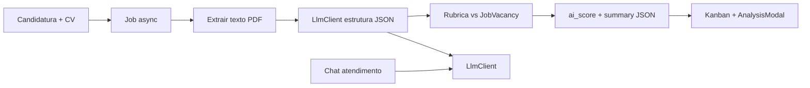

# Análise de currículo por IA + chat de atendimento no Gommo

> **Status:** adiado — aguardando comando do usuário para iniciar a **interface gráfica**  
> **Data:** 2026-07-27 (atualizado)  
> **Origem:** plano Cursor `ia_análise_currículo`  
> **Ordem de execução:** (1) UI com mocks → (2) integração LLM. **Não implementar UI até o usuário passar os comandos.**

## Overview

Arquitetura para:

1. **Análise/rankeamento de currículos** — pipeline híbrido (extração + rubrica determinística)
2. **Chat de atendimento** dentro do sistema — mesmo motor de LLM

Provedor inicial: **Gemini** (free tier). Upgrade futuro para **OpenAI** (ou outro) **somente via variáveis de ambiente**, sem alterar regras de negócio/UI.

## Contexto atual (já existe)

- Entidades: `Candidate`, `JobVacancy`, `JobVacancyApplication`, `CandidateExperience`
- CV: `storage_object` + link `entityType=candidate`, `linkRole=CURRICULUM`
- Candidatura pública: `PublicCareersService` + upload de resume
- UI: kanban de vagas, `CandidateAnalysisModal` (hoje só perfil, sem score)
- **Não existe** score/ranking nem chat de IA ainda

## O que grandes ATS fazem (Greenhouse, Lever, Recruitee)

Não pedem ao LLM "dê uma nota de 0 a 100" e pronto. O padrão efetivo é:

1. **Extrair** texto do PDF/DOCX
2. **Estruturar** (experiências, skills, formação, idiomas) via LLM ou parser
3. **Pontuar com rubrica** contra a vaga (requisitos, senioridade, stack) — regras + pesos
4. **Explicar** (matched / missing / risks) para o RH confiar
5. **Rodar assíncrono** — candidatura salva na hora; score chega depois



## Decisão fechada para o Gommo

### Arquitetura: módulo no monólito, não microserviço no MVP

```text
br.com.gommo.core.llm
  LlmClient                 // interface unica
  GeminiLlmClient           // default (free → pago)
  OpenAiLlmClient           // pronto no MVP para upgrade so com env
  LlmClientFactory          // le LLM_PROVIDER / LLM_MODEL / LLM_API_KEY

br.com.gommo.modules.rh.person.recruiting.ai
  ResumeTextExtractor
  ResumeParseService        // usa LlmClient → JSON estruturado
  VacancyFitScoringService  // rubrica deterministica
  ApplicationAiAnalysisJob  // @Async / fila

br.com.gommo.modules.cfg.settings.assistant (ou similar)
  SupportChatService        // usa o mesmo LlmClient
```

Extrair microserviço só se: milhares de CVs/dia, GPU própria, ou time separado dono do modelo.

### Troca Gemini → OpenAI sem alterar código de domínio

No MVP já entregar **os dois adapters**. Troca de provedor = só env:

```env
# Piloto / free
LLM_PROVIDER=gemini
LLM_MODEL=gemini-2.0-flash
LLM_API_KEY=...

# Upgrade futuro (sem mudar Java/TS de negocio)
LLM_PROVIDER=openai
LLM_MODEL=gpt-4o-mini
LLM_API_KEY=sk-...
```

Regras:

- Telas, jobs e services de CV/chat **nunca** importam SDK Gemini/OpenAI direto
- Só `LlmClient` + prompts/schemas
- Mesmo contrato de request/response para análise e chat (com `purpose`: `RESUME_PARSE` | `RESUME_SUMMARY` | `SUPPORT_CHAT`)

### Motor de currículo: híbrido (LLM + rubrica)

| Etapa | Como | Por quê |
|---|---|---|
| Extração de texto | Apache Tika / PDFBox no Java | Barato, estável, sem IA |
| Parse estruturado | `LlmClient` + JSON schema | Flexível com CVs PT-BR |
| Score 0–100 | Rubrica no código vs vaga | Explicável, estável |
| Resumo | LLM curto via `LlmClient` | UI no modal |

Não confiar só no "score do ChatGPT".

### Chat de atendimento

- Mesmo `LlmClient`
- Contexto: FAQs/ajuda do Gommo (depois: RAG leve se precisar)
- UI própria (a definir nos comandos do usuário)
- Sem decisão automática de RH; apenas suporte operacional

### Modelo recomendado

| Fase | Provider / modelo | Uso |
|---|---|---|
| Dev / piloto | Gemini Flash (free tier) | Custo ~zero |
| Produção Gemini | Gemini Flash pago | Upgrade de plano Google |
| Produção OpenAI | GPT-4o-mini | Troca só de env |
| Evitar no início | GPT-4o / Opus / fine-tune / Ollama | Caro ou ops pesado |

### Dá para fazer grátis?

- **Protótipo sim**: Gemini free tier
- **Produção**: API paga (PII/LGPD + rate limit)
- Ordem de grandeza GPT-4o-mini / Gemini Flash: **US$ 0.01–0.03 por CV**; 1.000/mês ≈ **US$ 10–30**

### Contrato de saída (candidatura)

Campos em `job_vacancy_application` (Flyway):

- `ai_score` (0–100, nullable)
- `ai_status` (`PENDING | READY | FAILED`)
- `ai_analyzed_at`
- `ai_analysis` JSONB:

```json
{
  "matchedSkills": ["Java", "Spring"],
  "missingSkills": ["Kubernetes"],
  "experienceYears": 4,
  "seniorityGuess": "PLENO",
  "summary": "Perfil alinhado em backend; falta cloud.",
  "risks": ["Gap de 18 meses"],
  "model": "gemini-2.0-flash",
  "provider": "gemini",
  "rubricVersion": "v1"
}
```

### Gatilhos (análise)

1. Após apply público / upload de CV → job async
2. Botão "Reanalisar" na UI de análise
3. Ordenação do kanban / lista por `ai_score`

### LGPD

- Não logar texto completo do CV
- Prompt mínimo necessário
- Preferir zero data retention
- Guardar `provider` + `model` + `rubricVersion`
- Score é apoio, não rejeição automática

## O que não fazer

- Microserviço "AI" no dia 1
- Embeddings/vector DB no MVP
- Score 100% LLM sem rubrica
- Análise síncrona no apply
- Chamar SDK do provedor fora de `LlmClient`

## Ordem de entrega (obrigatória)

1. **UI primeiro (mocks)** — score, resumo, ranking e chat com dados fake; **aguardar comando explícito do usuário** antes de qualquer tela
2. **Contrato/API mock** — endpoints/DTOs alinhados à UI
3. **`LlmClient` + Gemini + OpenAI adapters** + env
4. **Pipeline real de CV** (Tika → parse → rubrica → persist)
5. **Ligar chat** ao mesmo client
6. Evolução: pesos por vaga, RAG no chat, split de serviço se necessário

## Todos

- [x] Botão "Assistente IA" no header (pill ao lado do avatar)
- [x] Chat lateral direito (sidebar) abrindo pelo botão — UI mock
- [x] UI ranking de currículo (score %, modal, kanban/listagem) com mock
- [x] `LlmClient` + `GeminiLlmClient` + `OpenAiLlmClient` + factory por env
- [x] Ligar chat ao `LlmClient` (prompt inicial de rotas)
- [ ] Flyway `ai_score` / `ai_status` / `ai_analysis`
- [ ] Job async no apply + reanalisar
- [ ] Ligar UI de score/ranking ao backend real
- [ ] Enriquecer base do assistente (FAQ/fluxos)

## Próximo passo

Enriquecer o prompt do assistente e/ou pipeline real de análise de currículo.
