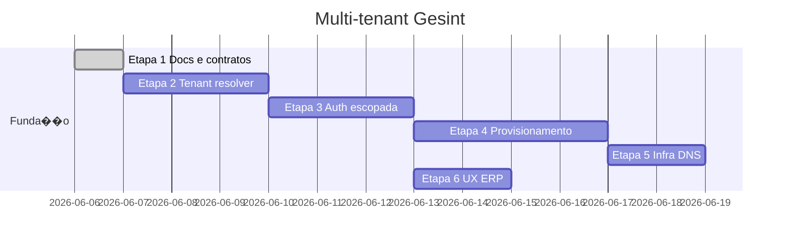

# Multi-tenant � plano de implementa��o

Etapas ordenadas para ligar control plane (admin) ao data plane (ERP).

**Documentos base:**

- [multi-tenant.md](./multi-tenant.md) � arquitetura
- [multi-tenant-dev.md](./multi-tenant-dev.md) � testes locais

**Branch sugerida:** `feat/multi-tenant` (a partir de `main` ap�s merge da folha)

---

## Vis�o geral



---

## Etapa 1 � Funda��o (documenta��o e contratos) ?

**Objetivo:** fixar decis�es e contratos antes de c�digo.

### Entreg�veis

- [x] `docs/arquitetura/multi-tenant.md`
- [x] `docs/arquitetura/multi-tenant-dev.md`
- [x] `docs/arquitetura/multi-tenant-implementacao.md` (este arquivo)
- [x] README raiz � links para arquitetura
- [x] `.env.example` � vari�veis dev tenant
- [ ] Regra de agente `.agents/rules/gesint-multi-tenant.mdc` (opcional, ap�s Etapa 2)

### Decis�es fechadas

| # | Decis�o |
|---|---------|
| 1 | MVP: `DEDICATED_SCHEMA` por tenant |
| 2 | Resolu��o prim�ria: header HTTP `Host` |
| 3 | Dev: `{slug}.localhost` + `GESINT_DEV_TENANT_SLUG` + `X-Tenant-Slug` |
| 4 | 1 tenant = 1 `public.company` no seed |
| 5 | Admin permanece URL fixa, sem tenant HR |

### Contratos t�cnicos (para Etapa 2)

#### `TenantContext` (thread-local / request scope)

```
clientId: UUID
slug: string
schema: string
provisioningStatus: enum
subscriptionStatus: enum (cache ou join)
```

#### `TenantResolver`

```
resolve(host: string, tenantHeader: string?): TenantContext
```

Ordem em dev:

1. Se `X-Tenant-Slug` presente e header habilitado ? buscar por slug
2. Extrair subdom�nio do Host
3. Se Host = localhost sem subdom�nio ? `GESINT_DEV_TENANT_SLUG`
4. Sen�o ? `CUSTOM_DOMAIN` lookup

#### Exce��es HTTP (HR)

| C�digo | HTTP | Quando |
|--------|------|--------|
| `TENANT_NOT_FOUND` | 404 | Host/slug desconhecido |
| `TENANT_NOT_READY` | 503 | Provisionamento pendente/erro |
| `TENANT_SUSPENDED` | 403 | Assinatura suspensa/cancelada |
| `TENANT_MISMATCH` | 403 | JWT tenant ? contexto |

---

## Etapa 2 � Tenant resolver (backend HR)

**Objetivo:** cada request HTTP ao `gesint-backend` conhece o tenant.

### Backend (`gesint-backend`)

| Item | Descri��o |
|------|-----------|
| `TenantContext` + `TenantContextHolder` | Request scope |
| `TenantResolver` | Host ? consulta `admin.client` (read-only repo ou JDBC) |
| `TenantResolutionFilter` | Antes do JWT; popula contexto |
| `TenantDataSourceRouter` ou `SchemaSwitchingConnection` | `SET search_path TO tenant_*` |
| Leitura `admin.client` | DataSource secund�rio ou same DB schema `admin` |
| Testes | Filter + resolver com Testcontainers |

### Frontend (`gesint-frontend`)

| Item | Descri��o |
|------|-----------|
| Middleware Next.js | Opcional: validar host, redirect se tenant inv�lido |
| `api.client.ts` | Enviar Host impl�cito (browser); dev doc para slug.localhost |
| P�gina erro tenant | �Ambiente n�o encontrado� |

### Crit�rio de aceite

- `GET empresa-a.localhost:8081/actuator/health` com contexto A
- Logs mostram `tenant=empresa-a schema=tenant_empresa_a`
- Request sem tenant v�lido ? 404/503 conforme tabela

---

## Etapa 3 � Autentica��o escopada

**Objetivo:** login e JWT amarrados ao tenant.

### Backend

| Item | Descri��o |
|------|-----------|
| Login | Resolver tenant **antes** de buscar `app_user` no schema correto |
| Validar `client_user` | `app_user_id` + `client_id` = tenant resolvido |
| JWT | Claims `tenantId`, `tenantSlug` |
| Filtro JWT | Rejeitar mismatch tenant JWT vs contexto |
| Refresh token | Escopado ao tenant (opcional: prefixo no storage) |

### Crit�rio de aceite

- Credenciais v�lidas em A falham em B (Host diferente)
- Token emitido em A n�o funciona com Host de B

---

## Etapa 4 � Provisionamento autom�tico

**Objetivo:** admin �Provisionar� cria ambiente real, n�o s� testa conex�o.

### Admin backend

| Passo | A��o |
|-------|------|
| 1 | `CREATE SCHEMA tenant_{slug}` |
| 2 | Rodar Flyway HR no schema |
| 3 | Seed: `company` a partir de `client`, roles, permiss�es do plano |
| 4 | Status ? `READY` ou `ERROR` + notes |

### Script dev

`scripts/provision-tenant-dev.mjs` � provisiona `empresa-a` / `empresa-b` para checklist local.

### Crit�rio de aceite

- Novo client no admin ? provisionar ? login HR funciona no subdom�nio
- Dois tenants isolados (colaborador criado em A invis�vel em B)

---

## Etapa 5 � Infraestrutura DNS (produ��o)

**Objetivo:** wildcard e HTTPS.

| Tarefa | Onde |
|--------|------|
| DNS `*.gesint.com.br` | Registrador / Cloudflare |
| Coolify wildcard domain | Traefik |
| CORS / env produ��o | `.env` Coolify |
| Documentar custom domain | `infra/coolify/README.md` |

---

## Etapa 6 � UX ERP (empresa impl�cita)

**Objetivo:** remover fric��o p�s-tenant.

| Tarefa | Arquivo / �rea |
|--------|----------------|
| Remover `CompanyPickerField` da compet�ncia | `PayrollRunFormClient` |
| `companyId` autom�tico no create | `PayrollRunService` � �nica `company` ativa |
| Ocultar coluna empresa na listagem se sempre 1 | `PayrollRunListClient` |
| Alinhar departamento / admiss�o | forms sem picker redundante |

Depende de Etapa 3 + seed Etapa 4.

---

## Etapas futuras (backlog)

- Pacotes de m�dulos por plano (`client permissions` UI)
- Gateway de pagamento
- `DEDICATED_DATABASE` autom�tico
- Multi-CNPJ dentro do mesmo tenant
- M�tricas por tenant (Grafana)

---

## Ordem de merge recomendada

1. Etapa 2 (resolver) � PR isolado, feature flag `GESINT_MULTI_TENANT_ENABLED`
2. Etapa 3 (auth) � depende de 2
3. Etapa 4 (provisionamento) � paralelo parcial a 3
4. Etapa 6 (UX) � ap�s 3+4
5. Etapa 5 (infra) � quando houver dom�nio produ��o

---

## Feature flag

At� estabilizar:

```env
GESINT_MULTI_TENANT_ENABLED=false   # comportamento atual single-schema public
GESINT_MULTI_TENANT_ENABLED=true    # resolver + schema switch
```

Permite desenvolver em branch longa sem quebrar dev local legado.
