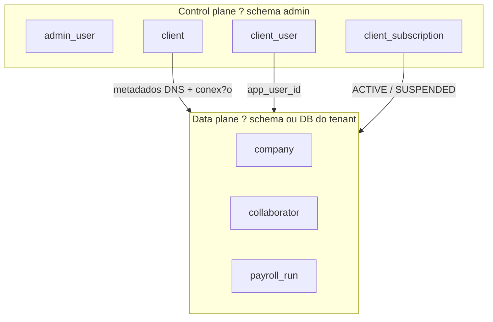
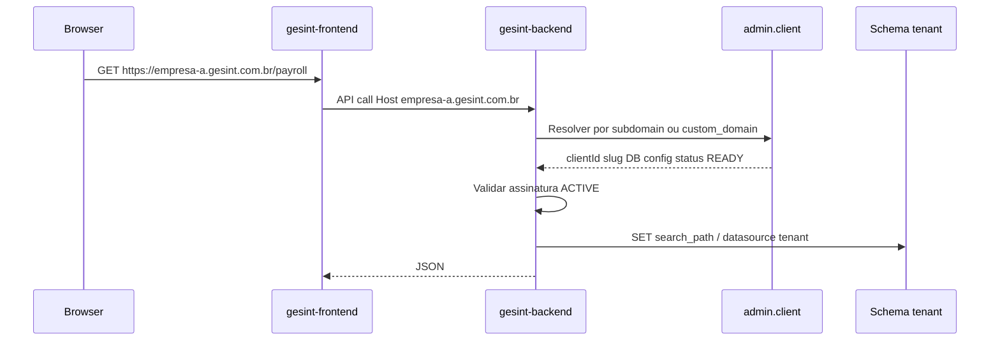

# Arquitetura multi-tenant ? Gesint

Documenta??o oficial do modelo **control plane + data plane** do Gesint ERP.

**Status:** em implementa??o (resolver, JWT, schema por tenant e frontend multi-host).

**Relacionado:**

- Painel admin: [gesint-admin-frontend/docs/TUTORIAL-PAINEL-ADMIN.md](../../gesint-admin-frontend/docs/TUTORIAL-PAINEL-ADMIN.md)
- Desenvolvimento local: [multi-tenant-dev.md](./multi-tenant-dev.md)
- Plano de implementa??o: [multi-tenant-implementacao.md](./multi-tenant-implementacao.md)

---

## 1. Vis?o de neg?cio

A **Gesint** vende licen?as de ERP de RH. Cada **cliente comprador** (tenant) opera o sistema de forma isolada:

| Ator | Sistema | URL (exemplo) |
|------|---------|---------------|
| Equipe Gesint (vendas, suporte) | Admin | `https://admin.gesint.com.br` |
| Cliente Empresa A (s?cios, RH, DP) | ERP HR | `https://empresa-a.gesint.com.br` |
| Cliente Empresa B | ERP HR | `https://empresa-b.gesint.com.br` |

O usu?rio do cliente **n?o escolhe empresa** ao usar folha, admiss?o ou departamentos. Ele j? est? no contexto da licen?a que comprou. A empresa do cadastro comercial (`admin.client`) coincide com o empregador legal (`company` no schema do tenant), criada no provisionamento.

---

## 2. Dois planos



| Plano | Schema / app | Conte?do |
|-------|--------------|----------|
| **Control plane** | `admin.*`, `gesint-admin-*` | Quem ? o cliente, subdom?nio, assinatura, operadores Gesint |
| **Data plane** | `tenant_*` ou DB dedicado, `gesint-backend` + `gesint-frontend` | Colaboradores, folha, ponto, f?rias |

O HR **nunca** consulta dados de RH de outro tenant no mesmo request. O admin **nunca** mistura metadados de clientes no data plane ? s? registra como conectar.

---

## 3. Conceitos

| Termo | Onde | Significado |
|-------|------|-------------|
| **Tenant** | `admin.client` | Cliente que comprou a licen?a (Empresa A) |
| **Slug** | `admin.client.slug` | Identificador curto (`empresa-a`) |
| **Subdom?nio** | `admin.client.subdomain` | Parte DNS (`empresa-a` ? `empresa-a.gesint.com.br`) |
| **Empresa (RH)** | `company` no schema do tenant | CNPJ empregador ? holerite, eSocial, contratos |
| **Operador plataforma** | `admin.admin_user` | Funcion?rio Gesint com `platform:admin` |
| **Usu?rio do tenant** | `admin.client_user` ? `public.app_user` | S?cio / admin inicial do cliente |

**Regra:** 1 tenant (licen?a) = 1 empresa empregadora no MVP. V?rios CNPJs no mesmo tenant ? cen?rio futuro (holding).

---

## 4. Resolu??o de tenant (produ??o)

Fluxo em cada request ao ERP:



### 4.1 Modos de roteamento (`routing_mode`)

| Modo | Campo | Exemplo |
|------|-------|---------|
| `SUBDOMAIN` | `subdomain` | `empresa-a.gesint.com.br` |
| `CUSTOM_DOMAIN` | `custom_domain` | `rh.empresa-a.com.br` |

### 4.2 Algoritmo de resolu??o (contrato)

1. Ler header `Host` (sem porta) ou `X-Tenant-Slug` (API separada / dev).
2. Se host = dom?nio admin ? **n?o** aplicar tenant (rotas admin usam outro backend).
3. Se host termina com `.gesint.com.br` ? extrair subdom?nio ? `WHERE subdomain = ?`.
4. Se n?o ? `WHERE custom_domain = ?`.
5. Validar `provisioning_status = READY` e assinatura `ACTIVE` (ou equivalente).
6. Publicar `TenantContext` (clientId, slug, schema) no thread/request.
7. `SET search_path TO "tenant_*", gesint_types` (fail-closed para tabelas).
   Enums vivem em `gesint_types` (sem tabelas). Sem tenant (`localhost` / platform) ?
   `search_path` = `public, gesint_types`. Consultas ao control plane usam `admin.*` schema-qualified.
8. Limpar contexto ao fim do request.

---

## 5. Isolamento de dados (decis?o MVP)

**Escolha:** `DEDICATED_SCHEMA` ? um schema PostgreSQL por tenant no mesmo cluster.

| Estrat?gia | MVP | Enterprise futuro |
|------------|-----|-------------------|
| `DEDICATED_SCHEMA` | **Sim** | ? |
| `DEDICATED_DATABASE` | Opcional manual | Clientes grandes / contrato |
| Coluna `tenant_id` em todas as tabelas | **N?o** | Risco alto em DP |

Exemplo local:

```
postgres / database gesint
??? admin                 (control plane)
??? public                (auth compartilhado + dev legado)
??? tenant_empresa_a      (RH Empresa A)
??? tenant_empresa_b      (RH Empresa B)
```

---

## 6. Autentica??o e escopo

### 6.1 Admin (`gesint-admin-backend`)

- JWT com `principalType=PLATFORM_ADMIN`.
- Acesso a `/api/v1/clients`, provisionamento, assinaturas.
- URL fixa: `admin.gesint.com.br`.

### 6.2 ERP (`gesint-backend`)

- JWT com `tenantId` (UUID do `admin.client`) ap?s login.
- Login valida:
  1. Tenant resolvido pelo `Host` ou header `X-Tenant-Slug`.
  2. Credenciais em `public.app_user` (auth compartilhado).
  3. `admin.client_user` liga `app_user_id` ao `client_id` do tenant resolvido.
- Request autenticado rejeitado se `JWT.tenantId` ? `TenantContext.clientId`.
- **Host sem subdom?nio** (`localhost` em dev): modo *platform* ? s? usu?rios em `admin.admin_user`, schema `public`.
- **Host com subdom?nio** (`empresa-a.gesint.com.br`): modo *tenant* ? dados de neg?cio no schema do cliente.

### 6.3 Frontend HR (`gesint-frontend`) ? multi-host

Cada tenant acessa o **mesmo deploy** Next.js por URL diferente. Implica??es:

| T?pico | Decis?o |
|--------|---------|
| Sess?o | Cookie por host ? sess?es **n?o** compartilhadas entre tenants |
| `AUTH_URL` no `.env` | Um valor can?nico ? **n?o** cobre todos os subdom?nios |
| Logout | `signOutToTenantLogin()` ? navega??o ?nica para `/api/auth/signout?callbackUrl=<login no host atual>` |
| Login tenant | Bloqueado em host sem subdom?nio quando `NEXT_PUBLIC_MULTI_TENANT_ENABLED=true` |
| API | Header `X-Tenant-Slug` derivado do hostname ou da sess?o |

Padr?o v?lido em **dev e produ??o** enquanto houver m?ltiplos hosts e `AUTH_URL` fixo no Auth.js.

**Produ??o (recomendado):** same-origin ? `https://empresa-a.gesint.com.br` serve UI e faz proxy de `/api` para o backend.

Detalhes de dev local: [multi-tenant-dev.md](./multi-tenant-dev.md).

### 6.4 Claims JWT (HR)

```json
{
  "sub": "<app_user_uuid>",
  "type": "access",
  "tenantId": "<client_uuid>",
  "tenantSlug": "empresa-a",
  "permissions": ["payroll:read", "..."]
}
```

---

## 7. Onboarding de novo cliente

Fluxo operado pela equipe Gesint no admin:

1. **Clientes ? Novo** ? nome, slug, CNPJ, contato, subdom?nio, schema (`tenant_empresa_a`).
2. **Testar conex?o** ? **Executar provisionamento** (schema + tabelas; Flyway por tenant em evolu??o).
3. **Assinatura** ? plano `PRO`, status `ACTIVE`.
4. **Usu?rios administrativos** ? login inicial do s?cio.
5. Cliente acessa `https://empresa-a.gesint.com.br` e completa cadastros.

### Seed no provisionamento (MVP)

| Artefato | Origem |
|----------|--------|
| `company` no schema tenant | Dados de `admin.client` (nome, CNPJ, contato) |
| Roles / permiss?es | Padr?o do plano |
| Primeiro admin | J? criado em `client_user` |
| `work_schedule` + `work_schedule_day` | Escala padrao (seg-sex, 44h) definida em `TenantDefaultDataProvisioner` |
| `admission_process_kanban_column` | 7 colunas padrao do kanban de admissao, sem cor |
| Perfis `Administrador <sistema>` | Copiados de `public.role` (`role_type = 'ADMIN'`) por `TenantRbacProvisioner` |

Tipos de perfil (`role.role_type`): `GLOBAL_ADMIN` (acesso total a todos os sistemas, usado no
primeiro acesso do cliente), `ADMIN` (acesso total dentro de um unico sistema, um por sistema,
imutavel), `INTERNAL` (perfis tecnicos da plataforma, fora da listagem) e `CUSTOM` (criados pelo
cliente). A listagem de perfis mostra apenas `ADMIN` e `CUSTOM`, e somente dos sistemas contratados.

Os seeds sao idempotentes e tambem rodam no `TenantSchemaBootstrap` e nos endpoints de
sincronizacao, para alcancar os tenants ja provisionados.

---

## 8. DNS e infraestrutura (produ??o)

| Registro DNS | Destino |
|--------------|---------|
| `admin.gesint.com.br` | `gesint-admin-frontend` |
| `admin-api.gesint.com.br` | `gesint-admin-backend` |
| `*.gesint.com.br` | `gesint-frontend` (wildcard) |
| API no **mesmo host** do app (recomendado) | `gesint-backend` via reverse proxy `/api` |
| `api.gesint.com.br` (alternativa) | `gesint-backend` + CORS por origem |

Traefik/Coolify encaminha todos os subdom?nios para o mesmo servi?o Next.js; **a aplica??o** resolve o tenant pelo `Host`.

### Dev vs produ??o (resumo)

| | Dev | Produ??o |
|---|-----|----------|
| Subdom?nio tenant | `{slug}.localhost` | `{slug}.gesint.com.br` |
| `GESINT_TENANT_BASE_DOMAIN` | `localhost` | `gesint.com.br` |
| API separada na porta | `:8081` / `:3000` | Preferir same-origin |
| Schema `public` | Dev legado + auth | Auth/enums; dados novos no `tenant_*` |

Dom?nio customizado: cliente configura CNAME `rh.cliente.com.br` ? `empresa-a.gesint.com.br`; registrar em `admin.client.custom_domain`.

Detalhes de deploy: [infra/coolify/README.md](../../infra/coolify/README.md).

---

## 9. Impacto no ERP (UX)

| Antes (single-tenant) | Depois (multi-tenant) |
|-----------------------|------------------------|
| Picker "Empresa" na compet?ncia | Removido ? `companyId` autom?tico |
| `localhost:3000` ?nico | `{slug}.localhost:3000` (tenant) ou `localhost` (platform) |
| Um schema `public` | Schema por tenant |
| Sem valida??o de assinatura | Bloqueio se `SUSPENDED` / n?o provisionado |

---

## 10. O que j? existe vs. o que falta

| Pe?a | Status |
|------|--------|
| `admin.client` + DNS + DB metadata | Implementado |
| CRUD assinatura / pagamento / client_user | Implementado |
| Tenant resolver + `search_path` no `gesint-backend` | Implementado |
| JWT com `tenantId` + valida??o `client_user` | Implementado |
| Provisionamento schema + clone tabelas (admin) | Implementado |
| Frontend: header tenant + logout multi-host | Implementado |
| Sincroniza??o de estrutura public -> schemas de tenant j? provisionados | Implementado |
| Filiais: hierarquia matriz/filial, escopo por `company_id`, permiss?es por filial | Implementado |
| Job provisionamento (Flyway por tenant + seed company) | Pendente |
| Wildcard DNS produ??o + same-origin API | Pendente (infra) |
| Remover picker empresa / auto `companyId` | Resolvido pelo seletor de filial |

---

## 10.1 Filiais (estabelecimentos)

Um tenant pode ter v?rias filiais. Filial ? a pr?pria `company`: no Brasil filial e estabelecimento
com CNPJ pr?prio s?o a mesma coisa, e folha, AFD do ponto, eSocial e FGTS s?o todos apurados por
estabelecimento. A hierarquia vive em `company.parent_id` / `company.is_headquarters`, com
exatamente uma matriz por tenant.

| Camada | Como funciona |
|--------|----------------|
| Escopo de dados | Entidades operacionais estendem `BranchScopedEntity` e carregam `company_id`. O filtro `branchScope` do Hibernate ? ligado por request no `BranchScopeAspect`; `@PrePersist` preenche a filial ativa na escrita. |
| Contexto | `BranchContextHolder` + header `X-Branch-Id`, espelhando o padr?o do tenant. `TenantContextTaskDecorator` propaga a filial para jobs `@Async`. |
| Permiss?es | `user_role` tem `company_id` na chave (`UserRoleAssignment`). O claim `permissions` do JWT ? a base que vale na maioria das filiais e `branchPermissions` lista apenas as filiais que fogem dela; `branchIds` delimita o acesso. O `JwtAuthenticationFilter` monta as authorities da filial ativa, o que preserva todos os `@PreAuthorize` existentes. Repetir a lista inteira por filial estourava o cookie de sess?o. |
| Cadastro | A matriz e o proprio cadastro do cliente (`admin.client`, Dados Basicos) e as filiais ficam em `admin.client_branch`. O `TenantBranchProvisioner` espelha as duas como `company` no schema do tenant, com as filiais penduradas na matriz por `parent_id`. Cliente sem linha em `client_branch` tem uma unica `company` e nem ve o seletor. |
| Migracao de schema | Os schemas de tenant sao clones estruturais de `public` e o Flyway nao os alcanca. O `TenantSchemaBootstrap` roda o sincronizador no start do admin-backend, o que evita que uma coluna nova derrube todos os tenants existentes. |
| Frontend | `ActiveBranchContext` + seletor no header; o workspace mant?m um grupo de abas por filial. |
| SQL nativo | N?o passa pelo filtro do Hibernate. Consultas nativas consultam `BranchScopedTables` e aplicam `AND company_id = :branchId` explicitamente. |

Leitura consolidada entre filiais exige `@BranchUnscoped`, que ? deliberadamente expl?cito.

---

## 11. Gloss?rio

| Termo | Defini??o |
|-------|-----------|
| Control plane | Admin + schema `admin` |
| Data plane | Banco/schema onde vive o RH do tenant |
| Provisionamento | Criar/validar ambiente isolado do tenant |
| Resolver | Mapear `Host` HTTP ? registro `admin.client` |
