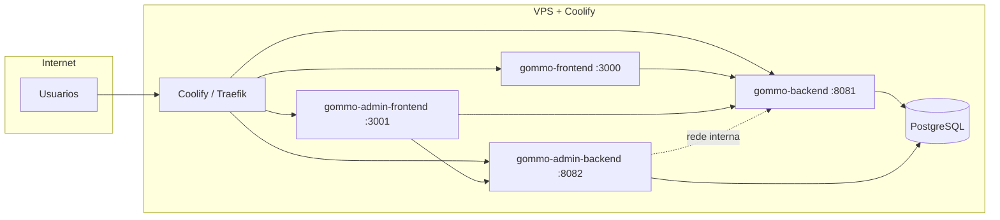

# Deploy Gommo com Coolify

O [Coolify](https://coolify.io) roda na sua VPS e faz build + proxy HTTPS dos containers.

**Caminho recomendado (VPS 8 GB / Hostinger KVM 2):** [4 Applications + 1 Database](#caminho-recomendado-apps-separados) — deploys isolados, menos pico de RAM.

**Alternativa (mais simples, pior no deploy):** [Docker Compose único](#alternativa-docker-compose-unico).

## Visão geral



Monorepo único no GitHub (`gommo`). No Coolify você cria **vários recursos** apontando para pastas diferentes do mesmo repo.

## Simulação local (builds como no servidor)

Cada app tem um `.env` no próprio diretório (mesmo formato do Coolify). Copie de `.env.example` se ainda não tiver.

| App | Arquivo |
|-----|---------|
| Client backend | `gommo-backend/.env` |
| Admin backend | `gommo-admin-backend/.env` |
| Client frontend | `gommo-frontend/.env` |
| Admin frontend | `gommo-admin-frontend/.env` |

**Nativo (IDE / mvn / next):** localhost lê esses `.env` (perfil `prod` nos backends; Next carrega `.env` automaticamente).

**Docker (simula deploy separado):** na raiz do monorepo (pare o `docker compose` de dev antes — mesmas portas):

```bash
docker compose -f infra/coolify/docker-compose.local.yml --env-file .env up -d --build
```

O compose usa `env_file` de cada pasta e só sobrescreve hostnames da rede (`DB_HOST=postgres`, `GOMMO_HR_BASE_URL=http://gommo-backend:8081`).

Build de um serviço só (como watch path no Coolify):

```bash
docker compose -f infra/coolify/docker-compose.local.yml build gommo-backend
docker compose -f infra/coolify/docker-compose.local.yml up -d gommo-backend
```

URLs: Client `http://localhost:3000` · Admin `http://localhost:3001` · APIs `:8081` / `:8082`.

## 1. Instalar Coolify na VPS

```bash
ssh root@SEU_IP_PUBLICO
curl -fsSL https://cdn.coollabs.io/coolify/install.sh | sudo bash
```

Acesse `http://SEU_IP:8000`, crie o usuário admin e conecte o servidor (localhost).

Na KVM 2 / VPS com 8 GB, crie **swap** antes do primeiro build:

```bash
sudo fallocate -l 8G /swapfile
sudo chmod 600 /swapfile
sudo mkswap /swapfile
sudo swapon /swapfile
echo '/swapfile none swap sw 0 0' | sudo tee -a /etc/fstab
free -h
```

## Caminho recomendado: apps separados

Um push que muda só o Client **não rebuilda** o Admin (com watch paths). Builds ficam menores e sequenciais por app — bem mais seguro em 8 GB de RAM.

### Checklist rápido

1. Criar **Database** PostgreSQL 16
2. Criar 4 **Applications** (mesmo repo Git, pastas diferentes)
3. Atribuir domínio/FQDN em cada app
4. Preencher envs (arquivos em [`env/`](env/))
5. Deploy na ordem: backends → frontends
6. (Opcional) Watch paths para isolar deploys

### 2. Database PostgreSQL

1. **+ Add Resource** → **Database** → **PostgreSQL** (16)
2. Anote (Coolify mostra após criar):
   - Host interno (ex.: `gommo-postgres` ou UUID do recurso)
   - Porta (`5432`)
   - User / Password / Database name
3. **Não** exponha o Postgres na internet

Sugestão de nomes no Coolify: `gommo-postgres`.

### 3. Criar as 4 Applications

Para **cada** app: **+ Add Resource** → **Application** → conecte o mesmo repositório Git do Gommo.

| Coolify name (sugestão) | Base Directory | Dockerfile | Build target | Porta | Limite RAM (KVM 2) |
|-------------------------|----------------|------------|--------------|-------|---------------------|
| `gommo-backend` | `/gommo-backend` | `Dockerfile` | **`prod`** | 8081 | 1792M |
| `gommo-admin-backend` | `/gommo-admin-backend` | `Dockerfile` | _(default)_ | 8082 | 640M |
| `gommo-frontend` | `/gommo-frontend` | `Dockerfile` | _(default)_ | 3000 | 512M |
| `gommo-admin-frontend` | `/gommo-admin-frontend` | `Dockerfile` | _(default)_ | 3001 | 256M |

Configuração comum a todas:

| Campo | Valor |
|-------|--------|
| **Repository** | mesmo monorepo `gommo` |
| **Build Pack** | Dockerfile |
| **Base Directory** | pasta da tabela acima (sem `infra/coolify`) |
| **Ports Exposes** | porta da tabela |

**Atenção — Client backend:** o `Dockerfile` tem stages `dev` e `prod`. No Coolify, em Build → **Docker Build Target** = `prod`. Sem isso o build pode pegar o stage errado.

**Persistent storage (só Client backend):**

| Mount path no container | Uso |
|-------------------------|-----|
| `/data/storage` | uploads / arquivos locais |

Crie um volume persistente no Coolify e monte em `/data/storage`.

### 4. Domínios (FQDN)

Em cada Application → Domains, use FQDN do Coolify (`*.sslip.io`) ou domínio próprio. HTTPS ligado. URLs **sem barra final**.

| App | Sugestão com domínio próprio |
|-----|------------------------------|
| `gommo-frontend` | `app.seudominio.com.br` |
| `gommo-backend` | `api.seudominio.com.br` |
| `gommo-admin-frontend` | `admin.seudominio.com.br` |
| `gommo-admin-backend` | `admin-api.seudominio.com.br` |

Anote as 4 URLs públicas — entram nas envs e nos **build args** dos Next.js.

### 5. Rede interna (Admin → Client)

`GOMMO_HR_BASE_URL` **não** é a URL pública **nem** a URL do frontend (`https://gommo.local`).

1. Abra a Application `gommo-backend`
2. Copie a **Internal URL** / hostname interno do Coolify (UUID do app ou nome fixo)
3. No Admin backend:

```text
GOMMO_HR_BASE_URL=http://<hostname-interno-do-gommo-backend>:8081
```

Exemplo típico: `http://gommo-backend:8081` (se o container name for esse).

Os dois backends e o Postgres precisam estar no **mesmo servidor** Coolify (mesma Docker network).

### 5.1 Lab LAN (`*.gommo.local`)

Arquivo pronto: [`env/lab-gommo.local.env`](env/lab-gommo.local.env).

Checklist mínimo para o Admin logar do Windows:

1. `AUTH_URL` / `NEXTAUTH_URL` do admin-frontend = `https://admin.gommo.local` (nunca `sslip.io`)
2. `NODE_TLS_REJECT_UNAUTHORIZED=0` no admin-frontend (cert self-signed; Auth.js chama a API no server)
3. Ports Exposes do admin-frontend = `3001`
4. Login: `https://admin.gommo.local` → `admGommo` / `GOMMO_PLATFORM_ADMIN_PASSWORD`
5. IntelliJ: em `gommo-db` marque **Make it publicly available**, porta `5432`, host `LAB_LAN_HOST`

### 6. Variáveis de ambiente

Arquivos prontos para copiar/colar:

| App | Arquivo |
|-----|---------|
| Client backend | [`env/client-backend.env.example`](env/client-backend.env.example) |
| Admin backend | [`env/admin-backend.env.example`](env/admin-backend.env.example) |
| Client frontend | [`env/client-frontend.env.example`](env/client-frontend.env.example) |
| Admin frontend | [`env/admin-frontend.env.example`](env/admin-frontend.env.example) |

Gere segredos (PowerShell):

```powershell
[Convert]::ToBase64String((1..32 | ForEach-Object { Get-Random -Maximum 256 }) -as [byte[]])
```

Mínimo: `JWT_SECRET`, `NEXTAUTH_SECRET` / `AUTH_SECRET`, `GOMMO_INTERNAL_EVENT_SECRET`, senha do Postgres.

**Build-time (Next.js):** `NEXT_PUBLIC_*` precisam estar disponíveis no **build** (Build Arguments / Build Variables no Coolify), não só em runtime. Depois de mudar essas URLs, faça **Redeploy with rebuild**.

| Build arg | App |
|-----------|-----|
| `NEXT_PUBLIC_API_URL` | `gommo-frontend` |
| `NEXT_PUBLIC_ADMIN_API_URL` | `gommo-admin-frontend` |
| `NEXT_PUBLIC_HR_API_URL` | `gommo-admin-frontend` |

### 7. Ordem do primeiro deploy

1. **Postgres** — healthy
2. **gommo-backend** — healthcheck `/actuator/health` (Flyway `public`)
3. **gommo-admin-backend** — Flyway schema `admin`; precisa de `GOMMO_HR_BASE_URL` interno
4. **gommo-frontend** — com `NEXT_PUBLIC_API_URL` já apontando para a FQDN do backend
5. **gommo-admin-frontend** — com as duas `NEXT_PUBLIC_*`

No startup, defina `GOMMO_PLATFORM_ADMIN_PASSWORD` (ou `DEV_ADMIN_PASSWORD`) para o `PlatformAdminBootstrap` criar o sudo `admGommo` — revise antes de usar em produção.

### 8. Watch paths (deploys isolados)

Em cada Application → Advanced / Watch Paths (sintaxe pode variar por versão do Coolify):

| App | Watch path |
|-----|------------|
| `gommo-backend` | `gommo-backend/**` |
| `gommo-admin-backend` | `gommo-admin-backend/**` |
| `gommo-frontend` | `gommo-frontend/**` |
| `gommo-admin-frontend` | `gommo-admin-frontend/**` |

Com isso:

- Push só em `gommo-frontend/` → rebuild só do Client web
- Push só em `gommo-backend/` → rebuild só da Client API
- Admin permanece no ar sem restart

Sem watch paths, o Coolify pode disparar deploy em todas as apps ligadas ao repo a cada push (mesmo com cache Docker). Configure os paths.

### 9. Limites de memória (KVM 2)

Partição sugerida (Admin leve, Client com mais folga):

| Serviço | Limite |
|---------|--------|
| Client backend | 1792M |
| Admin backend | 640M |
| Client frontend | 512M |
| Admin frontend | 256M |
| Postgres (Coolify DB) | ~768M |

No Client e Admin backends, mantenha:

```text
JAVA_TOOL_OPTIONS=-XX:MaxRAMPercentage=75.0 -XX:+ExitOnOutOfMemoryError
```

(já nos `.env.example` de cada backend).

---

## Alternativa: Docker Compose único

Mais simples de subir a primeira vez; **pior** em VPS 8 GB (build paralelo dos 4 serviços).

1. **+ Add Resource** → **Docker Compose**
2. Repositório Git do Gommo
3. Configuração:

| Campo | Valor |
|-------|--------|
| **Base Directory** | `/` (raiz do monorepo) |
| **Docker Compose location** | `infra/coolify/docker-compose.yml` |
| **Build pack** | Docker Compose |

4. Environment Variables: copie de [`.env.example`](.env.example)

Cada serviço do Compose (exceto `postgres`) precisa de FQDN pública. `GOMMO_HR_BASE_URL` fica `http://gommo-backend:8081` (hostname do compose).

Detalhes de URLs e troubleshooting gerais valem o mesmo espírito da secção de apps separados.

Na KVM 2, se o compose OOM no build: use swap + prefira o caminho de apps separados.

---

## Troubleshooting

| Sintoma | O que verificar |
|---------|-----------------|
| Build Maven falha / exit 255 sem erro de compile | Falta de RAM (OOM). Swap 8G; apps separados; um deploy por vez |
| CORS no browser | `CORS_ORIGINS` / `ADMIN_CORS_ORIGINS` com a FQDN **exata** do frontend (https, sem barra) |
| NextAuth redirect | `NEXTAUTH_URL` / `AUTH_URL` = FQDN do frontend, sem barra final |
| API aponta pro lugar errado | `NEXT_PUBLIC_*` no **build** + rebuild após mudar |
| Admin não fala com Client | `GOMMO_HR_BASE_URL` = URL **interna**, não a pública |
| 502 no proxy | Healthcheck; Postgres healthy; domínio no serviço certo |
| Flyway error | Volume PG antigo vs senha nova; schemas `public` e `admin` |
| Client backend sobe com stage errado | Docker Build Target = `prod` |
| Push no Client rebuilda Admin | Configurar watch paths |
| `STORAGE_UPLOAD_FAILED` no upload | Volume persistente em `/data/storage` no `gommo-backend`; env `STORAGE_LOCAL_PATH=/data/storage`; após deploy ver log `Storage local pronto` (ou erro de permissão no startup) |
| `JWT_SECRET` rejeitado | Mínimo 32 caracteres |
| Mudei senha do Postgres e backend não conecta | Volume guarda senha antiga — alinhar senha ou recriar DB (apaga dados) |
